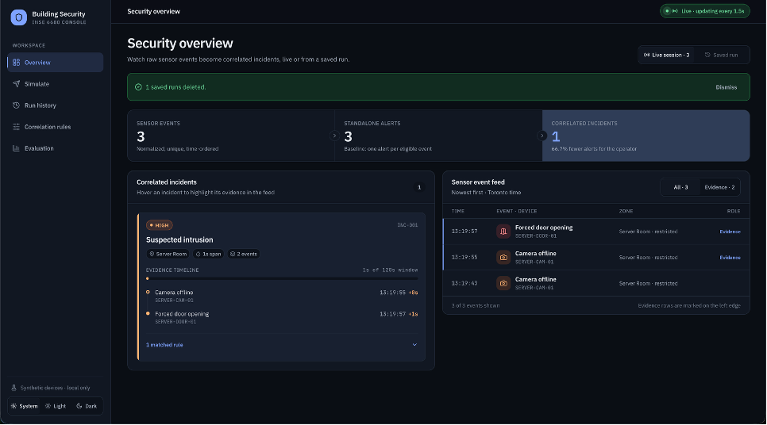
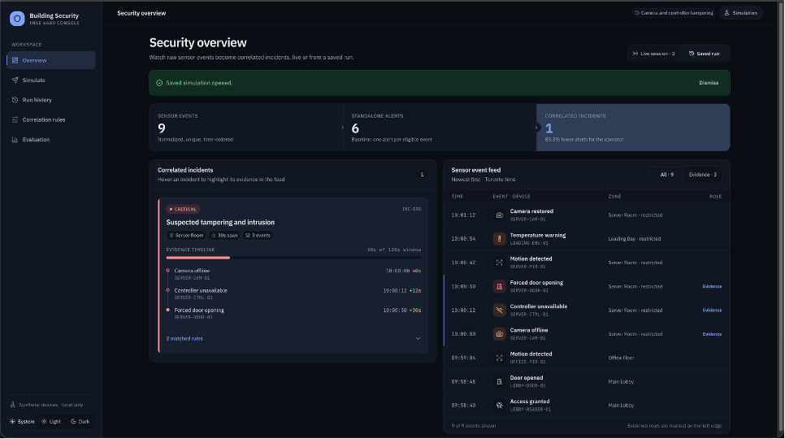
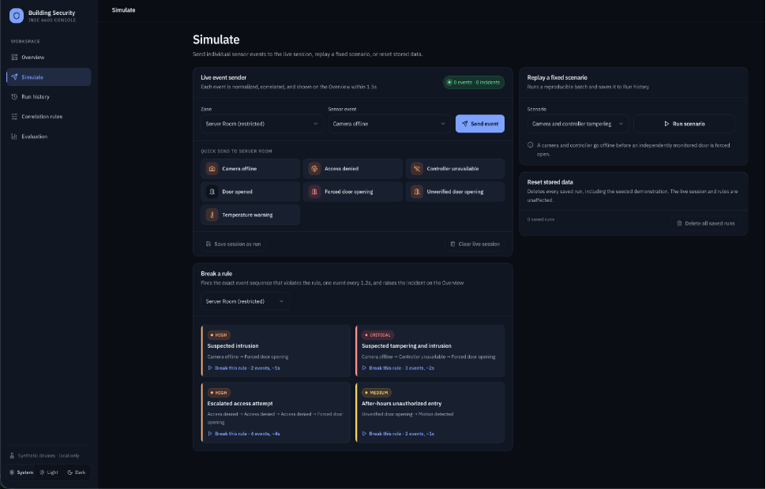
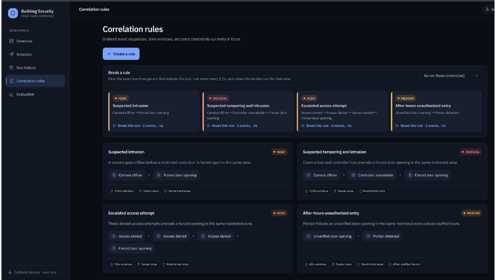
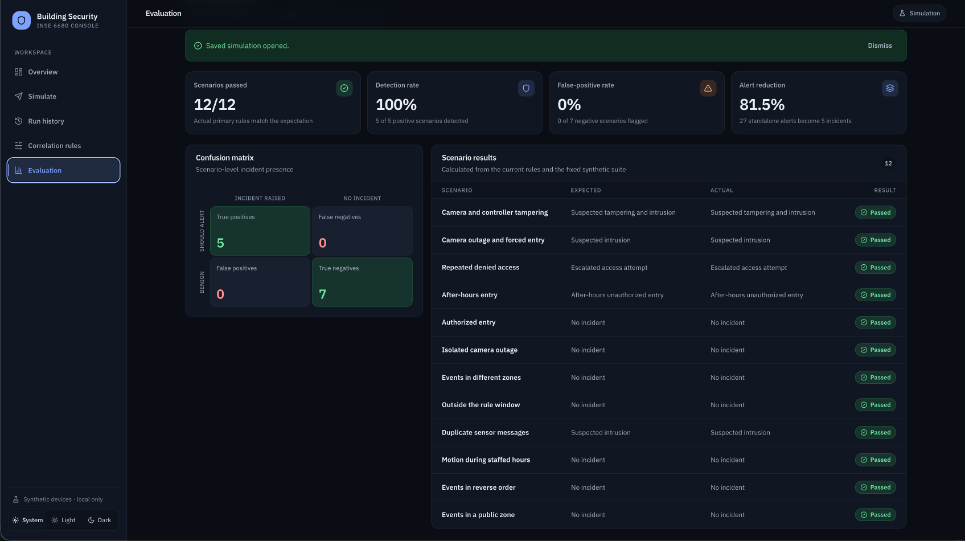

# Smart Building Security Console

<p align="center">
  <strong>Context-aware multi-sensor event correlation for smart building physical security.</strong><br>
  <em>INSE 6680 · Systems Physical Security · Concordia University</em>
</p>

<p align="center">
  
  
  
  
  
  
</p>

---

## Executive Summary

Modern physical security facilities suffer from severe **alert fatigue**: isolated sensors—such as door contacts, access badge readers, PIR motion sensors, and IP cameras—emit thousands of low-level signals every day. A single operational event or an adversary's deliberate intrusion can trigger dozens of uncoordinated alerts across disparate subsystems, blinding security operators to coordinated breaches.

The **Smart Building Security Console** solves this problem by ingesting heterogeneous, raw sensor telemetry, normalizing it into a unified event format, and applying temporal-spatial correlation across defined security zones. It condenses cascades of standalone alerts into actionable, high-fidelity security incidents complete with forensic evidence timelines.

In empirical testing against a fixed 12-scenario synthetic validation suite, this correlation engine achieved:
- **100% Detection Rate** (5/5 positive attack scenarios identified)
- **0.0% False Positive Rate** (0/7 benign operational scenarios flagged)
- **81.5% Alert Reduction** (27 standalone sensor alerts collapsed into 5 composite incidents)

---

## Visual Tour & Interface

### 1. Security Overview & Live Incident Correlation
Real-time dashboard visualizing composite incidents as they occur. Operators can inspect the full evidence timeline, see window progression, and cross-reference supporting events in the live feed.

<p align="center">
  
</p>

---

### 2. Multi-Sensor Tampering & Incident Forensics
Detailed investigation of a critical incident: an adversary knocks out an IP camera, disables the access controller, and forces the server room door open within a 120-second window. The correlation engine binds all three events into one prioritized incident with an audit-ready timeline.

<p align="center">
  
</p>

---

### 3. Simulation & Sensor Telemetry Injection
An interactive testing ground allowing operators to send individual raw signals (camera link down, unauthorized access attempt, door forced, temperature anomaly), replay benchmark scenarios, or trigger rule sequences.

<p align="center">
  
</p>

---

### 4. Correlation Rules & Rule-Breaking Engine
Inspect active built-in rules, define custom temporal-spatial policies, or use the **Break a rule** feature to simulate exact multi-step violation sequences in real time.

<p align="center">
  
</p>

---

### 5. Benchmark Evaluation & Confusion Matrix
Automated verification against reproducible physical security scenarios, displaying the scenario breakdown, confusion matrix (True Positives, False Positives, True Negatives, False Negatives), and operational alert reduction metrics.

<p align="center">
  
</p>

---

## Core Features

- **Multi-Sensor Normalization**: Normalizes disparate signals from cameras, door controllers, contacts, motion detectors, and environmental sensors into a standardized, time-ordered schema.
- **Context-Aware Correlation Engine**:
  - **Temporal Windows**: Enforces sliding time windows (e.g., within 60s, 90s, or 120s).
  - **Zone Confinement**: Restricts correlation strictly within common security zones (e.g., Server Room, Loading Bay).
  - **Restriction & Schedule Awareness**: Differentiates between public vs. restricted areas, and business hours vs. after-hours (Toronto local time / UTC normalized).
- **Incident Prioritization**: Deduplicates identical alerts and resolves overlapping rule matches, escalating to the highest severity and largest evidence footprint.
- **Interactive "Break a Rule" Execution**: Plays out attack vectors one step at a time with live visual progress feedback.
- **Custom Rule Builder**: Create and persist user-defined correlation rules with custom ordered sequences, severity levels, and geographic constraints without backend restarts.
- **Full Run History & Forensic Store**: Snapshot storage of all live sessions and replayed scenarios in SQLite (`data/security.sqlite3`) for retrospective auditing.
- **Unified Single-Binary Deployment**: The FastAPI backend directly serves the pre-compiled React 19 production build—no secondary reverse proxy required for standard deployment.

---

## System Architecture

```
                                  +-----------------------------+
                                  |   External Sensor Signals   |
                                  |  (PIR, Camera, Door, RFID)  |
                                  +--------------+--------------+
                                                 |
                                                 v
+---------------------------------------------------------------------------------------+
|  BACKEND (FastAPI + Pydantic v2 + SQLite)                                              |
|                                                                                       |
|   +-----------------------+     +------------------------+     +-------------------+  |
|   |  Signal Normalizer    | --> |  Correlation Engine    | --> |  Incident Store   |  |
|   |  (sensors.py)         |     |  (correlation.py)      |     |  (storage.py)     |  |
|   +-----------------------+     +------------------------+     +-------------------+  |
|               ^                             ^                                         |
|               |                             |                                         |
|   +-----------------------+     +------------------------+                            |
|   |  Live Simulation &    |     |  Rulebook & Policies   |                            |
|   |  Playback (live.py)   |     |  (rulebook.py)         |                            |
|   +-----------------------+     +------------------------+                            |
+--------------------------------------------+------------------------------------------+
                                             |  REST API & Static Assets
                                             v
+---------------------------------------------------------------------------------------+
|  FRONTEND (React 19 + Vite + Tailwind v4 + Lucide)                                    |
|                                                                                       |
|   [ Security Overview ]     [ Live Simulator ]     [ Rules ]     [ Evaluation ]       |
+---------------------------------------------------------------------------------------+
```

### Directory Structure

```
.
├── backend/
│   ├── security_console/
│   │   ├── main.py          # FastAPI application, REST endpoints, and asset serving
│   │   ├── models.py        # Pydantic schemas (Event, Rule, Incident, Run, etc.)
│   │   ├── sensors.py       # Zone layout definitions and raw-signal normalization
│   │   ├── correlation.py   # Multi-sensor de-duplication and temporal correlation
│   │   ├── simulation.py    # Synthetic scenario suite, simulator, and metrics
│   │   ├── live.py          # Real-time in-memory event session and playback runner
│   │   ├── rulebook.py      # Rule manager for default and dynamic custom rules
│   │   ├── storage.py       # SQLite persistent storage for runs and events
│   │   └── rules.json       # Built-in baseline correlation rules
│   ├── tests/               # Pytest suite for API endpoints and engine logic
│   ├── pytest.ini           # Test configuration
│   └── requirements.txt     # Python backend dependencies
├── frontend/
│   ├── src/
│   │   ├── App.jsx          # Single-page dashboard application (Overview, Rules, etc.)
│   │   └── styles.css       # Tailwind v4 theme, design tokens, and CSS variables
│   ├── index.html           # Application root HTML
│   ├── package.json         # Frontend dependencies and build scripts
│   └── vite.config.js       # Vite configuration with API reverse proxy
├── docs/
│   └── screenshots/         # Documentation screenshots and UI assets
└── README.md                # Project documentation
```

---

## Baseline Correlation Rules

The system ships with default physical security rules calibrated for enterprise facilities:

| Rule ID | Incident Title | Evidence Sequence | Window | Zone Policy | Severity |
| :--- | :--- | :--- | :---: | :---: | :---: |
| `camera-door` | **Camera outage and forced entry** | Camera offline → Forced door opening | 120 s | Same Restricted Zone | **High** |
| `camera-controller-door` | **Camera and controller tampering** | Camera offline → Controller unavailable → Forced door opening | 120 s | Same Restricted Zone | **Critical** |
| `denials-door` | **Repeated denied access** | 3× Access denied (badge) → Forced door opening | 90 s | Same Restricted Zone | **High** |
| `after-hours-motion` | **After-hours entry** | Unverified door opening → Motion detected | 60 s | Same Restricted Zone (Off-hours) | **Medium** |

*Note: Custom rules can be added dynamically via the `/api/rules` endpoint or the **Correlation Rules** UI tab.*

---

## Quickstart & Installation

### Prerequisites
- **Python**: 3.11 or later
- **Node.js**: 20.19+ or 22.12+ (with `npm`)

---

### macOS & Linux

1. **Clone the repository**:
   ```bash
   git clone https://github.com/Arya071/INSE-6680-Smart-Building-Security.git
   cd INSE-6680-Smart-Building-Security
   ```

2. **Set up Python Virtual Environment**:
   ```bash
   python3 -m venv .venv
   source .venv/bin/activate
   pip install -r backend/requirements.txt
   ```

3. **Install Frontend Dependencies & Build**:
   ```bash
   npm --prefix frontend install
   npm --prefix frontend run build
   ```

4. **Launch the Server**:
   ```bash
   python3 -m uvicorn security_console.main:app --app-dir backend --host 127.0.0.1 --port 8000
   ```

5. **Open the Dashboard**:
   - Web Console: [http://127.0.0.1:8000/](http://127.0.0.1:8000/)
   - Interactive Swagger API: [http://127.0.0.1:8000/docs](http://127.0.0.1:8000/docs)

---

### Windows (PowerShell)

1. **Set up Python Virtual Environment**:
   ```powershell
   py -3 -m venv .venv
   .\.venv\Scripts\Activate.ps1
   pip install -r backend\requirements.txt
   ```

2. **Install Frontend Dependencies & Build**:
   ```powershell
   npm.cmd --prefix frontend install
   npm.cmd --prefix frontend run build
   ```

3. **Launch the Server**:
   ```powershell
   .\.venv\Scripts\python.exe -m uvicorn security_console.main:app --app-dir backend --host 127.0.0.1 --port 8000
   ```

---

## Live Demonstration from Mobile Devices

The console includes a dedicated mobile-friendly sender interface in the **Simulate** tab:

1. Start the server bound to all local interfaces:
   ```bash
   python3 -m uvicorn security_console.main:app --app-dir backend --host 0.0.0.0 --port 8000
   ```
2. Find your machine's local IPv4 address (e.g. `192.168.1.50` via `ifconfig` or `ipconfig`).
3. Open `http://<your-ip>:8000/` on your laptop presentation screen on the **Overview** tab.
4. On a mobile phone connected to the same Wi-Fi network, navigate to:
   ```
   http://<your-ip>:8000/#simulate
   ```
5. Trigger events (e.g., *Camera offline* followed by *Controller unavailable* and *Forced door opening*). Observe the live incident assemble and raise on the main screen in real time.

---

## Evaluation Benchmark

The system includes an automated evaluation suite testing 12 diverse scenarios representing real-world physical security conditions:

```bash
PYTHONPATH=backend .venv/bin/pytest backend/tests -v
```

| Scenario ID | Classification | Expected Rule | Actual Output | Outcome |
| :--- | :--- | :--- | :--- | :---: |
| `tampering` | True Positive | `camera-controller-door` | Incident Raised (Critical) | **Passed** |
| `camera-door` | True Positive | `camera-door` | Incident Raised (High) | **Passed** |
| `repeated-denials` | True Positive | `denials-door` | Incident Raised (High) | **Passed** |
| `after-hours` | True Positive | `after-hours-motion` | Incident Raised (Medium) | **Passed** |
| `duplicate-events` | True Positive | `camera-door` | Incident Raised (Deduplicated) | **Passed** |
| `authorized-entry` | True Negative | None | Clean Baseline (No incident) | **Passed** |
| `camera-outage` | True Negative | None | Isolated Alert (No incident) | **Passed** |
| `different-zones` | True Negative | None | Boundary Enforced (No incident)| **Passed** |
| `outside-window` | True Negative | None | Temporal Window (No incident) | **Passed** |
| `staffed-hours` | True Negative | None | Schedule Respected (No incident) | **Passed** |
| `reverse-order` | True Negative | None | Sequence Enforced (No incident) | **Passed** |
| `public-zone` | True Negative | None | Policy Respected (No incident) | **Passed** |

**Summary Metrics:**
- **Accuracy**: 100% (12 / 12 passed)
- **Detection Rate (Recall)**: 1.0 (5 / 5)
- **False Positive Rate**: 0.0 (0 / 7)
- **Alert Reduction Ratio**: **81.5% reduction** (27 individual alerts down to 5 meaningful incidents)

---

## REST API Reference

| Method | Endpoint | Description |
| :--- | :--- | :--- |
| `GET` | `/api/health` | Health and liveness check |
| `GET` | `/api/scenarios` | Retrieve the 12 fixed benchmark scenario definitions |
| `GET` | `/api/rules` | Fetch all active correlation rules (built-in + custom) |
| `POST` | `/api/rules` | Register a new custom correlation rule |
| `DELETE` | `/api/rules/{id}` | Delete a custom correlation rule |
| `GET` | `/api/evaluation` | Execute full benchmark suite and return metrics |
| `GET` | `/api/runs` | List saved simulation and live session runs |
| `GET` | `/api/runs/{id}` | Get detailed event and incident breakdown for a run |
| `POST` | `/api/runs` | Execute and save a fixed benchmark scenario replay |
| `DELETE` | `/api/runs` | Wipe all saved run records from SQLite |
| `GET` | `/api/live` | Retrieve current live session state and version tag |
| `GET` | `/api/live/options` | Retrieve available zones and sensor signal options |
| `POST` | `/api/live/events` | Inject a single raw sensor event into the live stream |
| `POST` | `/api/live/play` | Step-by-step automated playback of a rule sequence |
| `POST` | `/api/live/save` | Persist current live session as a permanent run |
| `DELETE` | `/api/live` | Clear live session buffer |

---

## Development Mode

To run with frontend hot-reloading (Vite dev server) and FastAPI backend concurrently:

1. **Terminal 1 (Backend)**:
   ```bash
   python3 -m uvicorn security_console.main:app --app-dir backend --reload --port 8000
   ```
2. **Terminal 2 (Frontend)**:
   ```bash
   npm --prefix frontend run dev
   ```
   *Vite automatically proxies all `/api` requests to `http://localhost:8000`.*

---

## Academic Notice & Scope

This project was conceived and developed as part of **INSE 6680 (Systems Physical Security)** at **Concordia University**. It is designed as a laboratory prototype demonstrating algorithmic multi-sensor event correlation and alert fatigue mitigation under trusted synthetic environments.
